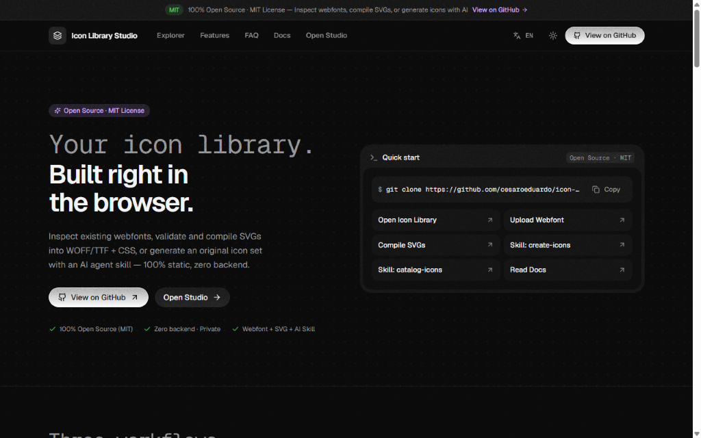
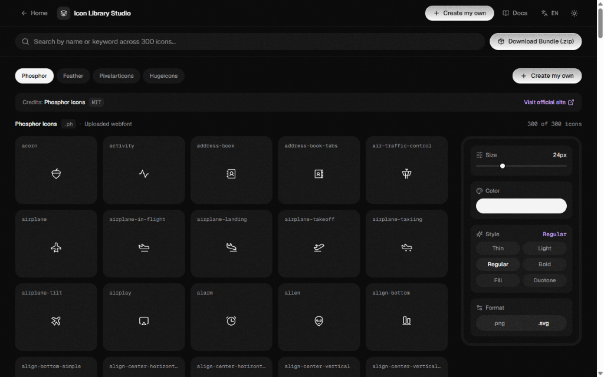
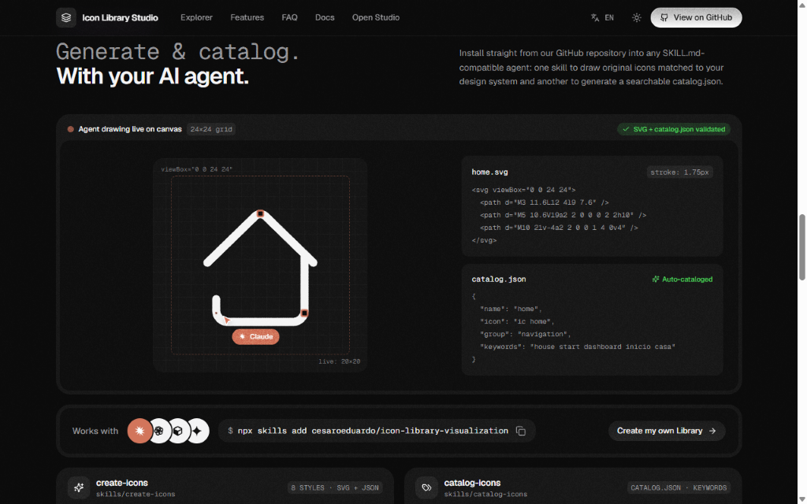

# Icon Library Studio

**Live site & docs:** [https://icons.cesaroeduardo.com](https://icons.cesaroeduardo.com) · **Studio app:** [https://icons.cesaroeduardo.com/studio/](https://icons.cesaroeduardo.com/studio/)

Open-source, 100% browser-based monorepo for inspecting webfonts, compiling SVGs into production webfonts (`.woff`, `.ttf`, `.css`, `catalog.json`), browsing popular open-source icon sets, and generating/cataloging original icons with AI coding agents.



## Icon Library Gallery

Browse **Phosphor Icons** (6 styles: `thin`, `light`, `regular`, `bold`, `fill`, `duotone`), **Feather Icons**, **Pixelarticons**, and **Hugeicons**, or upload your own webfont / SVGs to search, recolor, resize (`8px`–`320px`), copy HTML/SVG/PNG on hover, and export a complete `.zip` bundle.



## AI Agent Skills (`create-icons` & `catalog-icons`)

Install both skills directly from this repository into any `SKILL.md`-compatible agent (Claude Code, Antigravity, Cursor, Codex):

```bash
npx skills add cesaroeduardo/icon-library-visualization
```

Or install individually:

```bash
npx skills add cesaroeduardo/icon-library-visualization --skill create-icons
npx skills add cesaroeduardo/icon-library-visualization --skill catalog-icons
```



> The `create-icons` skill was inspired by [@banhosdev](https://x.com/banhosdev)'s [sergiobanhos/generate-icons](https://github.com/sergiobanhos/generate-icons).

## Repository Structure

```text
├── apps/
│   ├── web/            # Open-source Landing Page & TUFFUI Docs (React 19 + Tailwind CSS v4)
│   └── studio/         # Focused Icon Library app (Vue 3 + Tailwind CSS)
├── packages/
│   ├── core/           # Shared browser engine (SVG validator, SVG→TTF/WOFF compiler, Webfont & catalog.json parser)
│   └── skill/          # Skill packaging utilities
├── skills/
│   ├── create-icons/   # AI skill for generating original icon libraries (8 starter styles + catalog.json)
│   └── catalog-icons/  # AI skill for cataloging SVGs/webfont CSS into validated catalog.json with bilingual keywords
└── scripts/
    ├── build-all.mjs   # Unified static build -> dist/ (web + docs) + dist/studio/ (library app)
    └── fetch-demo-libraries.mjs
```

## Development

```bash
pnpm install

# Run Website & Docs (http://localhost:5173)
pnpm run dev:web

# Run Icon Library App (http://localhost:5174)
pnpm run dev:studio
```

## Production Build (Static Deploy)

```bash
pnpm run build
```

Outputs a unified static site in `dist/` ready for Cloudflare Pages, Vercel, Netlify, or GitHub Pages:
- `dist/` → Landing Page & Docs (`https://icons.cesaroeduardo.com`)
- `dist/studio/` → Icon Library Studio (`https://icons.cesaroeduardo.com/studio/`)

## Credits

- UI design language inspired by [TUFFUI](https://tuffui.com/)
- `create-icons` skill inspired by [@banhosdev](https://x.com/banhosdev) ([sergiobanhos/generate-icons](https://github.com/sergiobanhos/generate-icons))
- Demo icon libraries: [Phosphor Icons](https://phosphoricons.com/), [Feather Icons](https://feathericons.com/), [Pixelarticons](https://pixelarticons.com/), and [Hugeicons](https://hugeicons.com/) (all MIT)

## License

MIT
