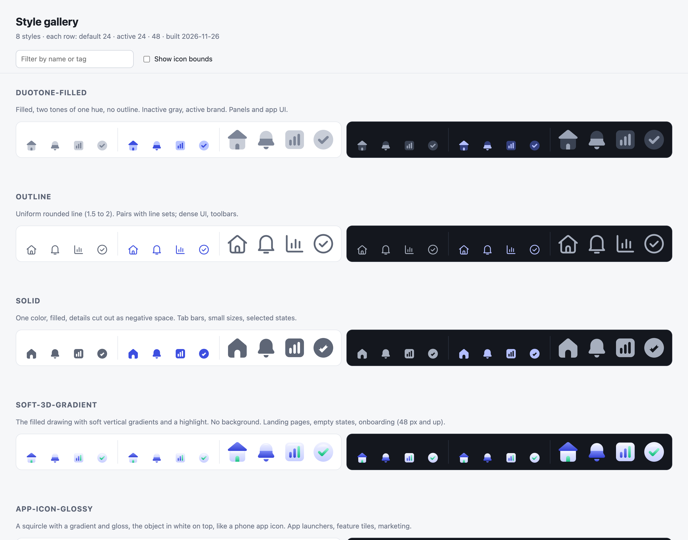
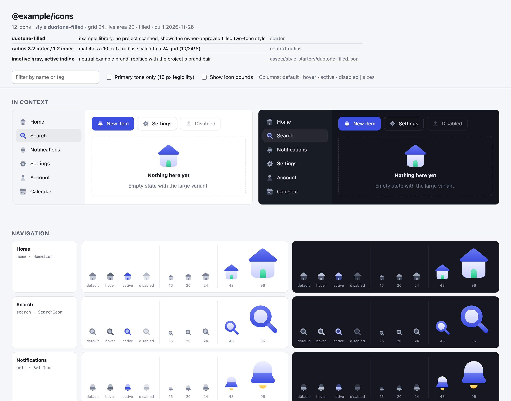

# create-icons

An agent skill that draws an **original icon library that matches your project's design system**.

It reads your tokens, theme, fonts and the icons you already use, turns that into an explicit
style sheet, proves it on a small sample shown next to your real UI, and only then draws the
whole set by hand as SVG. You get framework components, standalone SVGs, a sprite, CSS for
states and dark mode, a review catalog and a README, all validated.

> 🇧🇷 **Em português:** uma skill para agentes de IA (Antigravity, Claude Code, Cursor, etc.) que
> gera uma biblioteca de ícones original no estilo do seu design system. Lê seus tokens e ícones
> atuais, propõe o estilo, mostra uma amostra dentro da sua UI e só depois desenha tudo. Licença MIT.

## What you get

- **Style matched to your project**: grid, stroke or fill, tones, corner radius, states
  (default, hover, active, disabled), palette per theme. Every decision is written down with
  the file and line it came from.
- **A sample before the full set**: 6 to 8 icons rendered in a mock of your sidebar, buttons
  and empty state, in light and dark, side by side with the icons you use today.
- **Output for your stack**: React, Vue, Svelte, React Native or plain SVG. Tree-shakeable
  components with `size`, `title`, `currentColor` or token-driven tones, plus `svg/`,
  `sprite.svg`, `icons.css`, `manifest.json`, `catalog.html` and a README.
- **8 starter styles** for projects with no design system yet: outline, solid, duotone,
  soft 3D gradient, glossy app icon, flat color, pixel and hand-drawn.
- **Original drawings only**: the skill never copies paths from Lucide, Heroicons, Phosphor,
  Material or any other set, and never redraws brand logos. What it draws for you is yours.



## Install

Extract `create-icons.zip` into your agent's skills directory:

- **Antigravity**: `.agents/skills/create-icons`
- **Claude Code**: `~/.claude/skills/create-icons` or `.claude/skills/create-icons`
- **Cursor / Other SKILL.md agents**: `.cursor/skills/create-icons`

Requirements: Python 3.8+ (standard library only).

## Use

Ask your agent in plain words:

```
Use the create-icons skill to make icons for our sidebar and order statuses that match our design system.
```

The agent will:

1. Scan the design system (`scripts/scan_design_system.py`).
2. Ask only what the scan didn't settle (where the icons go, sizes, framework, location).
3. Write `icon-style.json` and show you each decision and why.
4. List icon candidates from your menus, routes, enums and emoji (`scripts/inventory.py`).
5. Draw a sample and open the catalog next to your current icons. You approve or adjust.
6. Draw and build the full library, validating every batch (`scripts/validate.py`, `scripts/build.py`).
7. Take your feedback per icon and rebuild only what changed.

## Examples

`examples/` has a finished 12-icon library in two styles, built for React. Open
`examples/duotone-filled/react/catalog.html` in a browser.



## What's inside

| Path | What |
|------|------|
| `SKILL.md` | The workflow the agent follows. |
| `scripts/` | Scanner, inventory, reference export, validator and builder. |
| `references/` | Style detection, interview, source format, drawing guide, the 8 styles, accessibility, licensing. |
| `assets/` | Starter style sheets and a gallery comparing them. |
| `examples/` | Two complete example libraries. |

## License

MIT. The icons the skill generates for you belong to you.
